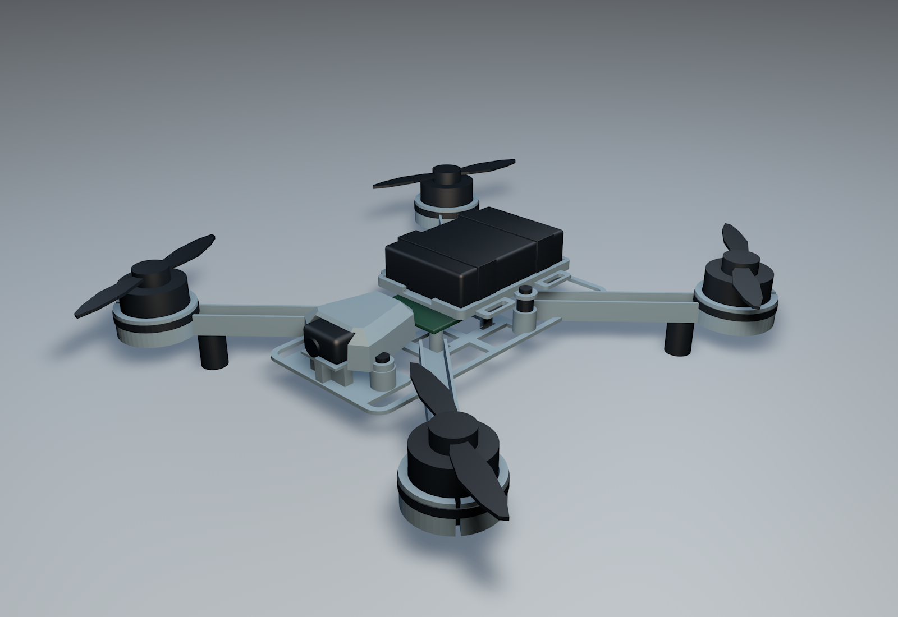
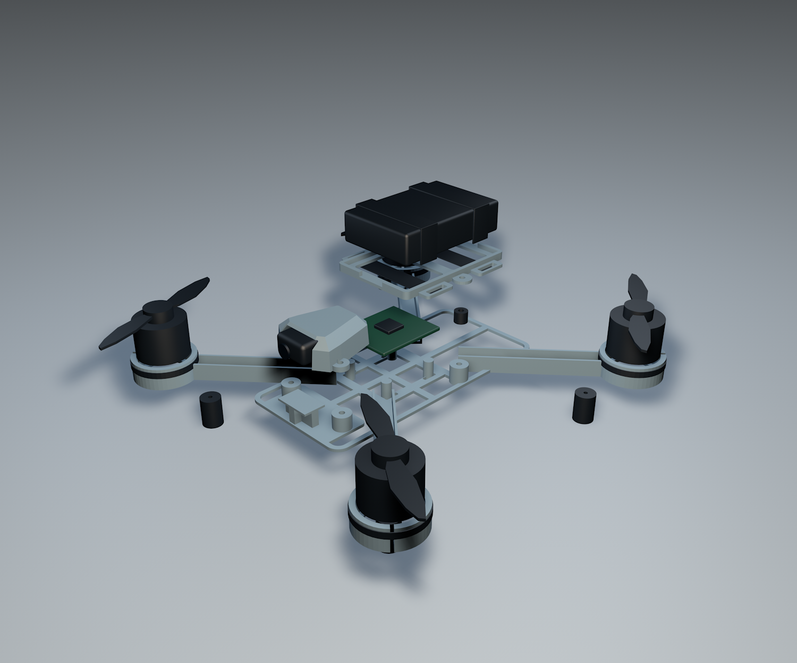

# Mini Wi-Fi Quad · 固定臂图传四轴

**V0.7 结构试装样机**：PLA/PETG 打印结构、Cinema 4D R21 场景与 ESP-Drone 编程参考。硬件尚未选定和实测，未完成刷机、图传或试飞。



项目目标是约 245 g 以内、约 ¥50 硬件预算（打印费另计）、固定机臂和手机画面回传。**这些是目标，不是已实现指标**：目前不能承诺总重量、动力、续航、图传质量或整机成本。渲染中的电子件为占位参考；没有集成机械云台。

| 内容 | 入口 |
| --- | --- |
| 完整设计与验证边界 | [10 页 PDF 报告](docs/quad-v07-structure-and-programming.pdf) |
| 打印数量、安装与紧固件 | [装配说明](docs/ASSEMBLY.txt) |
| OpenSCAD / STL / 3MF / C4D R21 | [cad/](cad/) |
| 尺寸图 / 接线框图 | [尺寸图](assets/quad-v07-dimensions.svg) · [接线图](assets/quad-v07-wiring.svg) |
| 程序与固定版飞控源码 | [编程说明](software/programming/PROGRAMMING.txt) |
| 报价记录与采购限制 | [2026-11-21 报价记录](procurement/README.md) |
| 几何、原生场景和协议检查 | [data/](data/) |

## 结构与尺寸

所有模型单位为 **mm**。装机共 **5 种、9 件打印件**，另有 2 种试装规。PETG 按密度 1.27 g/cm³ 计算，装机打印实体理论质量约 **23.612 g**，不含全部电子、电池、电机、桨、紧固件、保持带、胶、支撑和打印误差。

| 打印文件 | 数量 | 参考尺寸 / 用途 |
| --- | ---: | --- |
| [quad-frame-v07.stl](cad/quad-frame-v07.stl) | 1 | 152.8 × 148.8 × 8.7；一体机架 |
| [quad-foot-v07.stl](cad/quad-foot-v07.stl) | 4 | Ø8.4 × 12；机脚 |
| [quad-camera-cover-v07.stl](cad/quad-camera-cover-v07.stl) | 1 | 约 27.87 × 34.4 × 11；带耳短罩 |
| [wifi-quad-battery-tray-fit.stl](cad/wifi-quad-battery-tray-fit.stl) | 1 | 51.8 × 47.6 × 3；电池托 |
| [wifi-quad-battery-spacer.stl](cad/wifi-quad-battery-spacer.stl) | 2 | 高 4.5；电池托隔柱 |

参考桨扫掠总包络为 192 × 188 × 37.8。电机舱 Ø20.4、飞控 29 × 25、电池 48 × 32 × 12 都是**未实测占位包络**，不能据此直接购买硬件。Ø20.4 机座不能直接适配官方 716/720 裸电机。

先打印 [电机舱试装规](cad/quad-collar-gauge-v07.stl) 和 [短罩试装规](cad/quad-cover-gauge-v07.stl)，再用实际硬件修订 SCAD 参数。开口夹环仍需电机保持带和实际拔出、抗扭测试。PLA/PETG 的成品强度与温度表现尚未实测。



`cad/quad-v07-assembly-geometry.3mf` 保留 9 件装配位置，包含 5 个对象定义；它不是排好盘的切片项目，没有打印机配置或 G-code。C4D R21 场景使用实际 STL 网格、1 mm 单位；装配坐标以 [布局 JSON](data/wifi-quad-layout.json) 和 [结构检查记录](data/structure-check-v07.json) 为准。

## 两条电子路线

| 路线 | 当前可提供 | 尚未闭合 |
| --- | --- | --- |
| 低预算白牌拆机 | 保留同一套原配飞控、电机、桨、摄像头、App 和充电系统的装配思路 | 商品尺寸、套餐内容、手机回传、结构适配、最终价格；不保证能刷开源固件 |
| ESP-Drone 可编程参考 | 固定版官方源码、GPIO 来源、构建脚本、Python UDP/CRTP 客户端 | 对应飞控与驱动、机械接口、固件构建/刷机、视频集成与整机预算 |

两条路线未验证互换。GPIO 只控制匹配板上的电机驱动，不能直接连接电机。Python 客户端不含视频、航点、返航或自动起飞功能。

## 本地检查

Python 3.10+，主机检查只使用标准库。在仓库根目录运行：

```sh
python -m unittest discover -s tests -v
python tools/verify_artifacts.py
python software/esp_drone_client.py
```

最后一个命令默认只显示零油门数据包，不联网。实际发送和固件构建前先读 [PROGRAMMING.txt](software/programming/PROGRAMMING.txt)，按所选板型核对配置并拆桨进行台架检查。

| 检查 | 已记录结果 | 含义 |
| --- | --- | --- |
| 结构几何 | 63 项通过；STL 闭合/连通与装配包络检查 | 仅计算几何 |
| C4D 原生场景 | 保存后重读，毫米单位与 STL 包络一致 | 场景交付检查 |
| 主机协议 | 7 项通过，包含真实本机 UDP 回环 | 没有连接飞行器 |
| 实物与飞行 | 未完成 | 无实际称重、承载、推力、续航或图传测试 |

`tools/verify_artifacts.py` 可复核发布文件哈希、STL 包络/闭合/连通、3MF 对象数量及官方源码快照哈希。它不重新执行原设计环境中的全部 63 项几何检查；历史结果保存在 `data/`。发布清单 [manifest-v0.7.0.json](manifest-v0.7.0.json) 不包含自身和 `.git/`。

## 来源与使用范围

本项目不是 DJI 产品，未获得 DJI 背书。设计资料尚未另行授予开源许可；Python 客户端与对应测试使用 GPL-3.0-only，官方 ESP-Drone 快照保留上游许可证和声明。见 [LICENSE.md](LICENSE.md) 与 [第三方说明](THIRD_PARTY_NOTICES.md)。

English: a structural fit prototype for a fixed-arm PLA/PETG quadcopter, with native C4D R21 scenes and an ESP-Drone host-control reference. Hardware fit, total mass, video, endurance and flight remain unverified. This repository does not contain a validated flight-ready aircraft.
